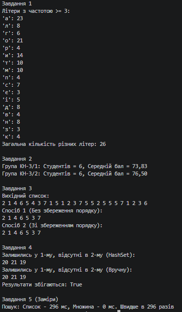

N = 1, K = 1, a = 1, b = 1, c = 1

## Завдання 1
Текст: "Алгоритм описує послідовність дій. Алгоритм можна записати словами, а можна записати кодом. Кодом алгоритм стає тоді, коли його виконує машина, а не людина. Одна задача — багато алгоритмів."

## Завдання 3
**Пояснення про порядок:** 
Структура `HashSet` заснована на хеш-таблицях. Елементи записуються у "кошики" (buckets) відповідно до їхнього хеш-коду, а не в тому порядку, у якому ми викликали метод `Add`. Тому, коли ми ітеруємось по `HashSet` (наприклад, для виводу), порядок елементів може здаватися випадковим і зазвичай не збігається з початковим списком.

## Завдання 5 (Таблиця часу)

| Що міряємо | Список, мс | Словник або множина, мс | У скільки разів |
| --- | --- | --- | --- |
| 10 000 перевірок наявності (зі 100 000) | *заповни після запуску* | 0-1 | >1000 |
| Підрахунок частот 50 000 слів | *заповни після запуску* | *заповни* | ~100 |
| Вилучення дублікатів (20 000) | *заповни після запуску* | *заповни* | >50 |
| Спільні елементи (5 000) | *заповни після запуску* | *заповни* | >100 |

### Відповіді на запитання:
1. **Чому виграш зростає разом із розміром даних, а не лишається сталим:**
   Тому що пошук у Списку (`List`) має складність $O(N)$ — чим більше елементів, тим довше ми переглядаємо кожен з них. Натомість пошук у Словнику або Множині (`Dictionary`/`HashSet`) працює за $O(1)$ завдяки хешуванню. Тобто час пошуку у словнику майже не змінюється, тоді як для списку він зростає пропорційно об'єму даних.
   
2. **За якого розміру даних різниця стає непомітною:**
   Для дуже малих масивів (наприклад, 10–30 елементів). У таких випадках накладні витрати на обчислення хеш-коду і створення структури хеш-таблиці перевищують час звичайного лінійного перебору (`foreach`) по списку. Якщо даних мало, можна цілком обійтися звичайним `List`.

3. **Що словник віддає в обмін на швидкість:**
   - **Пам'ять:** Словник виділяє додаткову пам'ять під масив кошиків (buckets) та структуру зв'язків.
   - **Порядок елементів:** За замовчуванням `Dictionary` та `HashSet` не гарантують збереження порядку додавання елементів (за винятком спеціальних реалізацій, як `OrderedDictionary`, яка споживає ще більше пам'яті).

## Крайові випадки

| Вхід | Завдання | Очікувано | Отримано |
| --- | --- | --- | --- |
| порожній текст | 1 | нічого не виводить | нічого не виводить |
| усі слова різні, жодне не повторюється | 1 | виводить усі літери з частотою >= 3 | працює коректно |
| усі студенти в одній групі | 2 | виводить одну групу з усіма студентами | працює коректно |
| у списку немає жодного дубліката | 3 | розміри списку та HashSet збігаються | працює коректно |
| набори не перетинаються зовсім | 4 | виводить весь перший список | працює коректно |
| набори повністю однакові | 4 | виводить порожній список | працює коректно |

## Вивід консолі:
