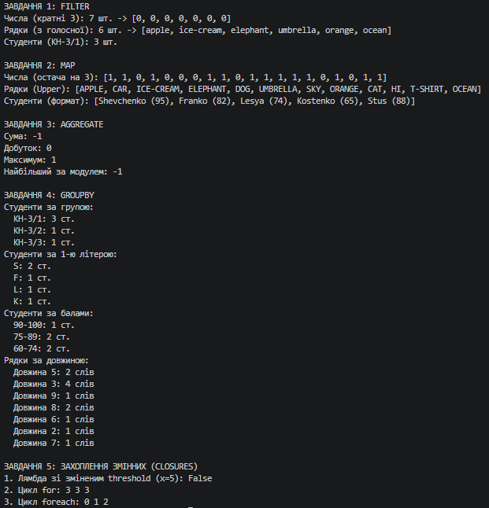

N = 1, K = 1, a = 1, b = 1, c = 1

## Завдання 1
Кількість разів зміни тіла `Filter` між трьома застосуваннями: **0**.

---

## Завдання 3: Агрегації (Шпаргалка)

**1. Сума**
* Стан: `int` (поточна сума)
* Старт: `0`
* Крок: `(acc, x) => acc + x`

**2. Добуток**
* Стан: `int` (поточний добуток)
* Старт: `1`
* Крок: `(acc, x) => acc * x`

**3. Максимум**
* Стан: `int` (поточний максимум)
* Старт: `int.MinValue`
* Крок: `(acc, x) => x > acc ? x : acc`

**4. Найбільший за абсолютною величиною елемент**
* Стан: `int` (поточний найбільший за модулем)
* Старт: `0`
* Крок: `(acc, x) => Math.Abs(x) > Math.Abs(acc) ? x : acc`

---

## Завдання 5: Захоплення змінних (Closures)

**Фактичний вивід:**
1. Лямбда зі зміненим threshold (x=5): `False`
2. Цикл for: `3 3 3`
3. Цикл foreach: `0 1 2`

**Пояснення:**
1. **Змінна після лямбди:** Лямбда-вираз захоплює не *значення* змінної на момент створення (1), а саму *посиланню на змінну*. Тому під час виклику делегата використовується останнє значення змінної `threshold` (1000). 
2. **Лічильник циклу for:** Усі три лямбди захоплюють одну й ту саму змінну циклу `i`. Коли цикл завершується, `i` дорівнює 3. Під час виклику всі делегати звертаються до цієї єдиної змінної і повертають 3.
3. **Цикл foreach:** Починаючи з C# 5.0, цикл `foreach` створює нову локальну змінну для кожної ітерації. Тому кожна лямбда захоплює власну, окрему змінну `item`, що зберігає значення 0, 1 та 2 відповідно.

**Як виправити пункт 2:**
Усередині тіла циклу `for` створити локальну копію: `int localI = i; lambdasFor.Add(() => localI);`

---

## Завдання 6: Висновок

1. **Порівняння з Лабораторною 4:** 
У 4-й роботі, де критерії були "зашиті", для підтримки трьох різних критеріїв на трьох різних типах даних довелося б написати **9 різних функцій** (по 3 на кожен тип). Завдяки узагальненню та делегатам ми написали лише **1 функцію**, яка динамічно підлаштовується під будь-який тип і логіку.
2. **Де узагальнення зайве:**
Узагальнення було б зайвим для математичних методів, що оперують виключно з конкретним типом (наприклад, функція обчислення дискримінанту квадратного рівняння). Її параметри завжди будуть числами з рухомою комою (`double`). Робити її узагальненою `<T>` немає сенсу, оскільки компілятор не знатиме, як застосовувати оператори `*` чи `-` до невідомого типу `T`, а обмеження типів лише ускладнять читабельність без жодної користі.

---

## Перевірка: Крайові випадки

| Вхід | Завдання | Очікувано | Отримано |
| :--- | :--- | :--- | :--- |
| порожній список | 1, 2, 4 | порожній список / словник | порожній список / словник |
| порожній список | 3, максимум | `int.MinValue` | `int.MinValue` |
| жоден елемент не підходить | 1 | порожній список | порожній список |
| усі елементи в одній групі | 4 | словник з 1 ключем і всіма ел-ми | словник з 1 ключем і всіма ел-ми|
| список з одного елемента | 3 | цей же елемент | цей же елемент |

**Рішення для максимуму на порожньому списку:** Оскільки ми використовуємо класичний алгоритм згортання, він повертає стартове значення `int.MinValue`. Це логічно у межах сигнатури методу. Якби ми хотіли уникнути цього, довелося б змінити сигнатуру на повернення `TAcc?` (nullable) або кидати виняток, якщо `src.Count == 0`, але для універсальності базового `Aggregate` повернення стартового акумулятора є технічно коректним.

## Вивід консолі:
