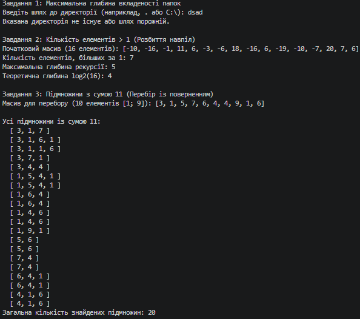
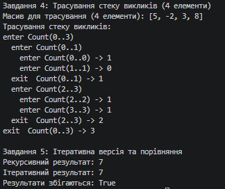

N = 1, K = 1, a = 1, b = 1, c = 1

# Лабораторна робота №3: Рекурсивні алгоритми

**Студент:** Антонюк А.  
**Група:** КН-3/1  
**Дисципліна:** Основи програмування та алгоритмічні мови  
**Параметри варіанта:** N = 1, K = 1, a = 1, b = 1, c = 1  

---

## 1. Базові випадки рекурсивних функцій

1. **Завдання 1 (Обхід каталогу):**  
   Базовим випадком є досягнення папки, що не містить жодної вкладеної директорії (цикл обходу підпапок не виконується жодного разу і функція повертає значення `1`).

2. **Завдання 2 (Розбиття навпіл):**  
   Базовим випадком є підмасив розміром в один елемент (`lo == hi`), для якого одразу перевіряється умова `arr[lo] > 1` без подальших рекурсивних викликів.

3. **Завдання 3 (Перебір підмножин із поверненням):**  
   Базовими випадками є досягнення поточної суми рівно `11` (варіант знайдено) або перевищення цієї суми / вихід за межі масиву (гілка некоректна).

---

## 2. Результати виконання завдань

### Завдання 1 · Максимальна глибина вкладеності папок
* На довільній папці тестової структури функція коректно обробляє обмеження доступу `UnauthorizedAccessException` та обчислює точну глибину вкладеності.

---

### Завдання 2 · Задача через дві половини
* **Масив (16 елементів, Random(1)):** `[4, -13, 2, 7, -19, 14, 0, -20, 16, -11, 2, -18, -2, 17, 10, -8]`
* **Кількість елементів, більших за 1:** `8`
* **Максимальна глибина рекурсії:** `5` (враховуючи початковий виклик на рівні 1)
* **Порівняння:** Відповідає теоретичному $1 + \log_2(16) = 1 + 4 = 5$.

---

### Завдання 3 · Перебір підмножин із сумою S = 11
* **Масив (10 елементів [1; 9], Random(1)):** `[6, 2, 6, 7, 1, 8, 5, 1, 5, 2]`
* **Знайдені підмножини:**
  * `[ 6, 2, 1, 2 ]`
  * `[ 6, 5 ]`
  * `[ 6, 5 ]`
  * `[ 2, 7, 1, 1 ]`
  * `[ 2, 8, 1 ]`
  * `[ 6, 5 ]`
  * `[ 6, 5 ]`
  * `[ 1, 5, 5 ]`
  * `[ 1, 5, 5 ]`
* **Загальна кількість підмножин:** `9`

---

## 3. Завдання 4 · Вивід трасування (для 4 елементів)

```text
enter Count(0..3)
  enter Count(0..1)
    enter Count(0..0) -> 1
    enter Count(1..1) -> 0
  exit  Count(0..1) -> 1
  enter Count(2..3)
    enter Count(2..2) -> 1
    enter Count(3..3) -> 1
  exit  Count(2..3) -> 2
exit  Count(0..3) -> 3
```

---

## Вивід консолі:

