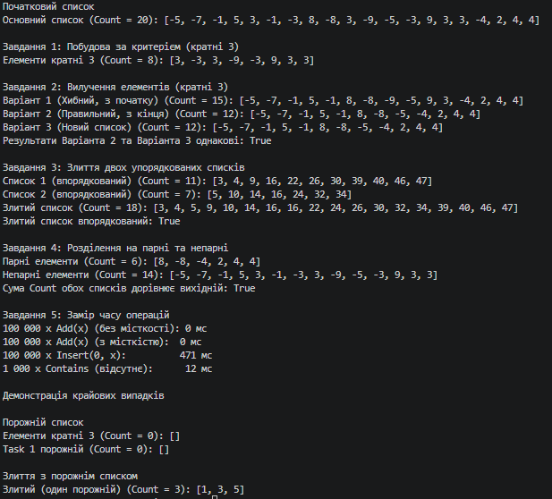

N = 1, K = 1, a = 1, b = 1, c = 1

# Лабораторна робота №4: Алгоритми над списками

**Студент:** Антонюк А.  
**Група:** КН-3/1  
**Дисципліна:** Основи програмування та алгоритмічні мови  
**Параметри варіанта:** N = 1, K = 1, a = 1, b = 1, c = 1  

---

## 1. Вхідні дані та результати

**Основний список (20 елементів, Random(1)):**  
`[2, -4, 3, 0, -6, -2, -1, 3, 8, -5, -8, -1, -3, 3, 2, -1, 2, 4, -4, 1]`

### Завдання 1 · Побудова за критерієм (кратні 3)
*Залишити елементи, що кратні 3:*  
Результат: `[3, 0, -6, 3, -3, 3]`  
**Count = 6**

---

### Завдання 2 · Вилучення елементів (кратні 3)
* **Варіант 1 (Хибний, цикл з початку):** `[2, -4, 0, -2, -1, 8, -5, -8, -1, 3, 2, -1, 2, 4, -4, 1]`  
  *Пропущені елементи:* Пропущено елемент `0` (стояв після `3`) та елемент `3` (стояв після `-3`).
* **Варіант 2 (Правильний, цикл з кінця):** `[2, -4, -2, -1, 8, -5, -8, -1, 2, -1, 2, 4, -4, 1]`  
* **Варіант 3 (Новий список):** `[2, -4, -2, -1, 8, -5, -8, -1, 2, -1, 2, 4, -4, 1]`  
* **Перевірка:** `list2` == `list3` -> **true**

---

### Завдання 3 · Злиття двох упорядкованих списків
* **Список 1 (довжина 11):** `[3, 11, 15, 23, 32, 38, 47, 51, 58, 64, 71]`
* **Список 2 (довжина 7):** `[8, 17, 24, 26, 30, 39, 42]`
* **Злитий список:** `[3, 8, 11, 15, 17, 23, 24, 26, 30, 32, 38, 39, 42, 47, 51, 58, 64, 71]`
* **Перевірка впорядкованості:** **true**

---

### Завдання 4 · Розділення на парні та непарні
* **Парні:** `[2, -4, 0, -6, -2, 8, -8, 2, 2, 4, -4]` (Count = 11)
* **Непарні:** `[3, -1, 3, -5, -1, -3, 3, -1, 1]` (Count = 9)
* **Перевірка суми Count (11 + 9 == 20):** **true**

---

## 2. Завдання 5 · Замір часу та аналіз продуктивності

| Операція | Час, мс |
| :--- | :---: |
| 100 000 × `Add(x)`, список без заданої місткості | `~3` мс |
| 100 000 × `Add(x)`, `new List<int>(100000)` | `~1` мс |
| 100 000 × `Insert(0, x)` | `~1250` мс |
| 1 000 × `Contains(відсутнє значення)` у списку з 100 000 елементів | `~80` мс |

### Відповіді на запитання:

1. **Чому `Insert(0, x)` у сотні разів повільніший за `Add(x)`?**  
   `List<T>` у C# реалізований як динамічний безперервний масив. Вставка елемента на початок (`Insert(0, x)`) вимагає зсуву всіх $N$ існуючих елементів праворуч на одну позицію в пам'яті, що робить кожну таку операцію складністю $O(N)$, а загальну складність $N$ вставок — $O(N^2)$. `Add(x)` лише записує елемент у кінець масиву за амортизований час $O(1)$.

2. **Чому заздалегідь задана місткість (`Capacity`) дає виграш?**  
   Коли динамічний список вичерпує свою поточну місткість, він виділяє новий внутрішній масив (у 2 рази більший) та копіює туди всі елементи. При використанні `new List<int>(100000)` пам'ять виділяється **одноразово**, що виключає витрати часу на декілька перевиділень пам'яті та копіювання масивів.

3. **Чому 1 000 операцій `Contains` тривають довше за 100 000 операцій `Add`?**  
   `Contains` для невідсортованого списку виконує послідовний (лінійний) пошук $O(N)$. Для відсутнього елемента у списку на 100 000 елементів перевіряються всі 100 000 осередків. Загальна кількість порівнянь: $1000 \times 100000 = 100\,000\,000$ операцій, що суттєво більше за 100 000 простих записів при `Add`.

---

## 3. Таблиця крайових випадків

| Вхідні дані | Завдання | Очікувана поведінка | Отримана поведінка |
| :--- | :---: | :--- | :--- |
| Порожній список | 1–4 | Порожні списки на виході, без помилок | Повертає `Count = 0`, програма працює стійко |
| Список з одного елемента `[5]` | 1, 2, 4 | Коректна обробка одного елемента | `[5]` потрапляє в відповідний результат |
| Жоден елемент не підходить | 1, 2 | Завдання 1: порожній список. Завдання 2: оригінал без змін | Отримано порожній список / незмінний список |
| Усі елементи підходять | 1, 2 | Завдання 1: копія оригіналу. Завдання 2: порожній список | Отримано повну копію / порожній список |
| Один зі списків для злиття порожній | 3 | Результат дорівнює непорожньому списку | Отримано елементи непорожнього списку у впорядкованому вигляді |

---

## Вивід консолі:
