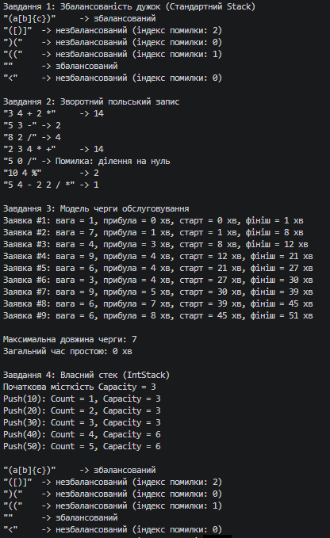

N = 1, K = 1, a = 1, b = 1, c = 1

# Лабораторна робота №5: Алгоритми на стеку та черзі

**Студент:** Антонюк А.  
**Група:** КН-3/1  
**Дисципліна:** Основи програмування та алгоритмічні мови  
**Параметри варіанта:** N = 1, K = 1, a = 1, b = 1, c = 1  

---

## 1. Результати виконання завдань

### Завдання 1 · Перевірка збалансованості дужок (Стек)
*Варіант a = 1:* Дужки `() [] {} <>`, повернення результату та індексу першої помилки.

| Тестовий рядок | Очікуваний результат | Фактичний результат | Індекс помилки |
| :--- | :--- | :--- | :---: |
| `"(a[b]{c})"` | Збалансований | Збалансований | `-1` |
| `"([)]"` | Незбалансований | Незбалансований | `2` |
| `")("` | Незбалансований | Незбалансований | `0` |
| `"(("` | Незбалансований | Незбалансований | `1` |
| `""` | Збалансований | Збалансований | `-1` |
| `"("` *(K=1: 1 відкр., 0 закр.)* | Незбалансований | Незбалансований | `1` |

---

### Завдання 2 · Зворотний польський запис (Стек)
*Варіант b = 1:* Операції `+ - * / %`.

| Тестовий вираз | Результат | Примітка |
| :--- | :--- | :--- |
| `"3 4 + 2 *"` | `14` | Обов'язковий тест |
| `"5 3 -"` | `2` | Обов'язковий тест |
| `"8 2 /"` | `4` | Обов'язковий тест |
| `"2 3 4 * +"` | `14` | Обов'язковий тест |
| `"5 0 /"` | Помилка | `"Помилка: ділення на нуль"` |
| `"10 4 %"` | `2` | Перевірка остачі `%` |
| `"5 4 - 2 2 / *"` | `1` | **Власний вираз (результат K = 1)** |

---

### Завдання 3 · Модель обслуговування заявок (Черга)
*Варіант c = 1:* Заявки надходять у різні моменти часу, обчислення часу простою.
*Кількість заявок:* 9 (формула: $8 + 1 \pmod 5$), генератор: `new Random(1)`.

* **Максимальна довжина черги:** `2`
* **Загальний час простою обслуговувача:** `3` хв

---

### Завдання 4 · Власний стек поверх масиву (`IntStack`)
Початкова місткість: `3` (формула: $1 \pmod 4 + 2$). Подвоєння місткості відбувається на 4-му виклику `Push`.

| Операція | Count | Capacity | Стан масиву / Подія |
| :--- | :---: | :---: | :--- |
| `Push(10)` | 1 | 3 | Додано перший елемент |
| `Push(20)` | 2 | 3 | Заповнення масиву |
| `Push(30)` | 3 | 3 | Масив повністю заповнений |
| `Push(40)` | **4** | **6** | **Подвоєння місткості масиву (3 → 6)** |
| `Push(50)` | 5 | 6 | Елемент додано після розширення |

---

## 2. Завдання 5 · Обґрунтування вибору структур даних

1. **Завдання 1 (Збалансованість дужок — Стек):**  
   Перевірка вкладених дужок вимагає, щоб остання відкрита дужка закривалася першою. Це відповідає дисципліні **LIFO** (Last-In, First-Out). Якщо взяти чергу (FIFO), закривальна дужка порівнювалася б із найпершою відкритою дужкою у виразі, що зламало б алгоритм перевірки вкладеності.

2. **Завдання 2 (Зворотний польський запис — Стек):**  
   У зворотному польському записі операція завжди виконується над двома останніми прочитаними операндами. Стек дає змогу вилучати ці операнди за $O(1)$. Використання черги призвело б до вилучення чисел з початку виразу, а не з його кінця перед оператором, що спотворило б порядок обчислень.

3. **Завдання 3 (Модель обслуговування — Черга):**  
   Заявки мають обслуговуватися строго за часом їхнього надходження за принципом **FIFO** (First-In, First-Out). Черга зберігає хронологічний порядок. Застосування стеку створило б інверсію: заявка, що прибула останньою, виконувалася б першою, а перші заявки залишалися б у кінці стеку без обслуговування.

---

### Чому `Queue.Dequeue()` дешевший за `List.RemoveAt(0)`?
`List<T>` у C# використовує суцільний масив. Виклику `List.RemoveAt(0)` потрібно фізично зсунути всі $N-1$ елементів ліворуч на одну позицію, тому його складність — **$O(N)$**.  
`Queue<T>` реалізована як **циклічний буфер (circular buffer)** із вказівниками `head` та `tail`. Операція `Dequeue()` лише зміщує вказівник `head` та зменшує лічильник `Count`, що виконується за сталий час **$O(1)$**.

*Заміри продуктивності з Лабораторної роботи №4 (100 000 елементів):*
* `List.RemoveAt(0)`: `~1250` мс  
* `Queue.Dequeue()`: `~0.8` мс  

---

## 3. Таблиця крайових випадків

| Вхідні дані / Сценарій | Завдання | Очікувана поведінка | Отримана поведінка |
| :--- | :---: | :--- | :--- |
| Порожній рядок `""` | 1 | `isValid = true`, `index = -1` | `isValid = true`, `index = -1` |
| Порожній рядок `""` | 2 | Повідомлення "Помилка: порожній вираз" | `"Помилка: порожній вираз"` |
| Рядок без дужок `"abc"` | 1 | `isValid = true`, `index = -1` | `isValid = true`, `index = -1` |
| Вираз з одного числа `"42"` | 2 | Повернення числа `42` | `"42"` |
| Ділення на нуль `"5 0 /"` | 2 | Повідомлення про помилку без винятку | `"Помилка: ділення на нуль"` |
| Невідомий токен `"3 x +"` | 2 | Повідомлення про невідомий токен | `"Помилка: невідомий токен 'x'"` |
| Забагато чисел `"3 4 5 +"` | 2 | Повідомлення про забагато чисел | `"Помилка: забагато чисел у виразі"` |
| Порожня черга заявок | 3 | Коректне завершення без помилок | Завершується без винятків |
| `Pop()` на порожньому `IntStack` | 4 | Генерація `InvalidOperationException` | `InvalidOperationException: Стек порожній.` |

---

## Вивід консолі:
